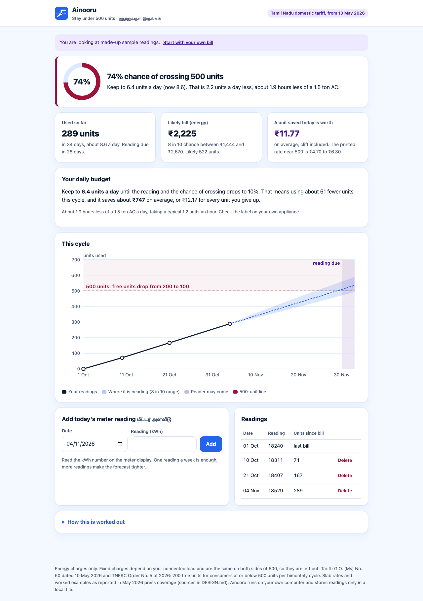

<p align="center"></p>

# Ainooru

**Stay under 500 units.** Ainooru (ஐநூறு, Tamil for "five hundred") forecasts a Tamil Nadu household's two-month electricity cycle from a few meter readings. It tells the family, before the meter reader comes, whether they will cross the 500-unit line and what crossing it would cost.

## The problem

Since 10 May 2026, a Tamil Nadu home that uses 500 units or fewer in a two-month cycle gets 200 units free. At 501 units only 100 are free, and the whole bill moves to a costlier table.

| Units in the cycle | Energy charge |
|---|---|
| 500 | ₹1,570.00 |
| 501 | ₹2,048.40 |

That one unit costs ₹478.40. Before May 2026 it cost ₹243.40, so the cliff has almost doubled. Families only find out where they stand when the bill arrives.

## What Ainooru shows

* The chance of crossing 500 units by the reading date, allowing for a reader who comes a few days late.
* The likely bill, as a median with an 8 in 10 range.
* What a unit saved today is really worth once the cliff is counted. For a home on course for exactly 500 units it is about ₹10 at mid-cycle, and it passes ₹40 two days before a reading whose date is known. The printed rate near the line is ₹4.70 to ₹6.30.
* A daily unit budget that brings the risk down to 10%, with the expected saving and the cut in hours of AC.
* When the cliff is already lost, so the family stops sacrificing comfort for nothing.



## Run it

You need [uv](https://docs.astral.sh/uv/). It installs the right Python for you.

```sh
git clone <this repository> ainooru
cd ainooru
uv sync
uv run uvicorn ainooru.app:app --port 8000
```

Open http://localhost:8000. Click **Try it with sample readings** to see a household near the line, or enter the reading date and value from your last bill and add today's meter reading.

Readings are stored in `data/ainooru.sqlite3` on your own machine. Set `AINOORU_DB` to use another file.

## Tests

```sh
uv run pytest
```

The tests cover:

* the tariff, including the published worked examples (500 units cost ₹1,570; 600 units cost ₹2,880) and the exact cliff values;
* the forecaster: risk ordering, lateness, and a check that the daily budget really hits its 10% target;
* the web flow, including the rejection of impossible readings.

## How it works

* `ainooru/tariff.py` holds both tariff versions (before and after 10 May 2026) as telescopic slab tables, with exact decimal billing.
* `ainooru/forecast.py` estimates the recent daily rate, weighted towards the last two weeks. It then simulates the rest of the cycle 4,000 times, with day-to-day variation that persists across days, uncertainty in the rate estimate, and a random reader delay. Every path ends in whole units and an exact bill.
* `ainooru/charts.py` draws the cycle chart as plain SVG on the server.
* The pages are Jinja templates served by FastAPI, with no JavaScript framework.

## Limitations

* Only energy charges are compared. Fixed charges depend on connected load and are the same either side of 500.
* The day-to-day variation settings are provisional defaults until the backtest in `eval/` is complete.
* The tariff figures come from published reporting of G.O. (Ms) No. 50 and TNERC Order No. 5 of 2026; see `DESIGN.md` for sources. Check them against your own bill.
* The AC conversion assumes a typical 1.2 units an hour for a 1.5 ton inverter split AC.

## Credits

FastAPI, Jinja2, Uvicorn, NumPy and pytest. Tariff facts are sourced in `DESIGN.md`. Built for LaunchPad Hacks 2026; all code was written during the event.
